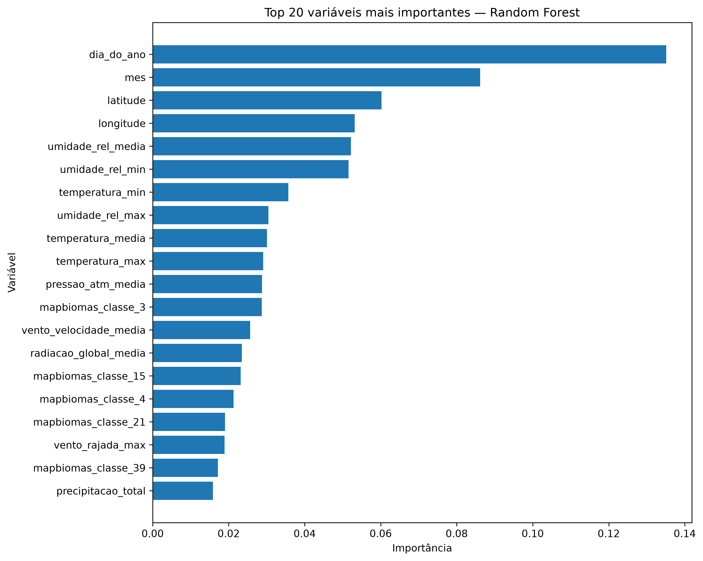

# Previsão de Risco de Incêndios no Brasil

## Visão geral

Este projeto desenvolve uma pipeline de Machine Learning para classificação do risco de incêndio no Brasil, utilizando dados de queimadas, condições meteorológicas, localização geográfica e cobertura e uso da terra.

O objetivo é classificar o risco em três categorias:

- **Baixo**
- **Médio**
- **Alto**

O projeto foi desenvolvido como parte do projeto final do programa de Data Science da TripleTen Brasil.

---

## Fontes de dados

O projeto integra dados provenientes de diferentes fontes públicas.

### Queimadas

Registros de focos de queimadas utilizados como base principal da análise, incluindo informações como:

- município;
- data e hora;
- latitude e longitude;
- dias sem chuva;
- precipitação;
- risco de fogo;
- potência radiativa do fogo.

Período utilizado: **2024 a fevereiro de 2025**.

### INMET

Dados meteorológicos provenientes de estações automáticas do Instituto Nacional de Meteorologia.

Entre as variáveis utilizadas estão:

- precipitação;
- temperatura;
- umidade relativa;
- pressão atmosférica;
- radiação global;
- velocidade do vento;
- rajadas de vento.

Foram utilizados dados de **2024 e 2025**.

### MapBiomas

Dados de cobertura e uso da terra por município.

Como os dados disponíveis utilizados neste projeto vão até **2021**, as proporções das classes de cobertura do solo de 2021 foram utilizadas como características ambientais estáticas para o período analisado.

---

## Preparação dos dados

As diferentes bases apresentavam granularidades e coberturas temporais distintas.

Os registros de queimadas foram agregados por:

**município + dia**

Para cada município e dia foram calculadas diferentes estatísticas, incluindo o maior valor diário de risco de fogo.

Os dados meteorológicos horários do INMET foram transformados em informações diárias.

Como nem todos os municípios possuem uma estação meteorológica, cada município presente na base de queimadas foi associado à **estação meteorológica disponível mais próxima**, utilizando distância geográfica calculada com Haversine.

Os valores meteorológicos ausentes são tratados dentro da pipeline de Machine Learning utilizando imputação pela mediana calculada exclusivamente sobre os dados de treinamento.

---

## Variável alvo

A variável alvo foi construída a partir do maior valor de risco de fogo registrado para cada combinação município-dia.

As categorias utilizadas foram:

| Categoria | Intervalo |
|---|---|
| Baixo | 0,00 – 0,40 |
| Médio | > 0,40 – 0,70 |
| Alto | > 0,70 – 1,00 |

Após a remoção das observações sem variável alvo válida, a base destinada à modelagem possui **308.991 observações**.

Distribuição das classes:

| Classe | Observações | Percentual |
|---|---:|---:|
| Baixo | 80.447 | 26,04% |
| Médio | 22.918 | 7,42% |
| Alto | 205.626 | 66,55% |

A distribuição mostra um problema de classificação desbalanceado, principalmente devido à menor representação da classe Médio.

---

## Modelos avaliados

Foram avaliados:

- Dummy Classifier;
- Regressão Logística;
- Random Forest;
- Random Forest com ajuste de hiperparâmetros.

Devido ao desbalanceamento das classes, a avaliação considera não apenas Accuracy, mas também:

- **Balanced Accuracy**
- **F1 Macro**
- métricas individuais por classe.

---

## Resultados

| Modelo | Accuracy | Balanced Accuracy | F1 Macro |
|---|---:|---:|---:|
| Dummy Classifier | 0,6655 | 0,3333 | 0,2664 |
| Regressão Logística | 0,6800 | 0,5903 | 0,5538 |
| Random Forest | 0,8367 | 0,7392 | 0,7040 |
| Random Forest Ajustado | 0,8431 | 0,7336 | 0,7050 |

O Random Forest apresentou o melhor equilíbrio geral entre as classes.

Embora o Random Forest ajustado tenha alcançado uma Accuracy e F1 Macro ligeiramente superiores, o Random Forest original apresentou maior Balanced Accuracy e melhor capacidade de identificação da classe Médio.

---

## Validação temporal

Além da divisão aleatória estratificada, foi realizada uma validação temporal.

O modelo foi treinado com dados anteriores a dezembro de 2024 e testado em observações entre dezembro de 2024 e fevereiro de 2025.

Resultados:

| Métrica | Resultado |
|---|---:|
| Accuracy | 0,6999 |
| Balanced Accuracy | 0,5540 |
| F1 Macro | 0,5516 |

O desempenho inferior ao observado na divisão aleatória mostra que a generalização para períodos futuros é mais difícil.

Na validação temporal, as classes Baixo e Alto mantiveram resultados relativamente consistentes, enquanto a classe Médio apresentou maior dificuldade de classificação.

Esse resultado demonstra a importância de utilizar validações temporais em problemas ambientais sujeitos a mudanças sazonais e temporais.

---

## Importância das variáveis

A análise de importância do Random Forest mostrou forte participação de variáveis relacionadas à sazonalidade, localização e condições meteorológicas.

Entre as principais variáveis estão:

- dia do ano;
- mês;
- latitude;
- longitude;
- umidade relativa;
- temperatura;
- pressão atmosférica;
- velocidade do vento;
- radiação solar;
- classes de cobertura do solo do MapBiomas.



As importâncias representam a contribuição das variáveis para as decisões do modelo e não devem ser interpretadas como relações causais.

---

## Limitações

Uma limitação importante deste projeto é que a base de queimadas contém registros de eventos detectados.

Consequentemente, o modelo desenvolvido **não prevê diretamente se um novo incêndio ocorrerá ou não em qualquer município brasileiro**.

A tarefa consiste em prever a **categoria de risco de fogo derivada do indicador `risco_fogo` para observações município-dia presentes na base de queimadas**.

Para desenvolver um sistema de previsão direta da ocorrência de incêndios, seria necessário construir uma base contendo também municípios e dias sem registros de focos.

Outras limitações incluem:

- utilização do MapBiomas 2021 como referência ambiental para 2024–2025;
- utilização da estação meteorológica disponível mais próxima;
- distâncias elevadas até estações meteorológicas em algumas regiões;
- presença de valores meteorológicos ausentes;
- forte desbalanceamento da variável alvo;
- redução de desempenho observada na validação temporal.

---

## Próximos passos

Possíveis evoluções do projeto incluem:

- construção de uma base completa município-dia incluindo dias sem incêndios;
- previsão direta da ocorrência de novos focos;
- inclusão de dados mais recentes de cobertura do solo;
- melhoria da identificação da classe Médio;
- incorporação de novos períodos meteorológicos;
- validação temporal contínua;
- monitoramento de data drift e desempenho;
- desenvolvimento de uma API ou aplicação para disponibilização das previsões.

---

## Estrutura do projeto

```text
ProjetoFinalTripleTenBrazil/
│
├── data/
│   ├── raw/
│   └── processed/
│
├── figures/
│   └── feature_importance_random_forest.png
│
├── models/
│   └── random_forest_risco_incendio.joblib
│
├── notebooks/
│   ├── 01_data_understanding.ipynb
│   └── 02_data_preprocessing.ipynb
│
├── reports/
├── src/
├── .gitignore
├── README.md
└── requirements.txt